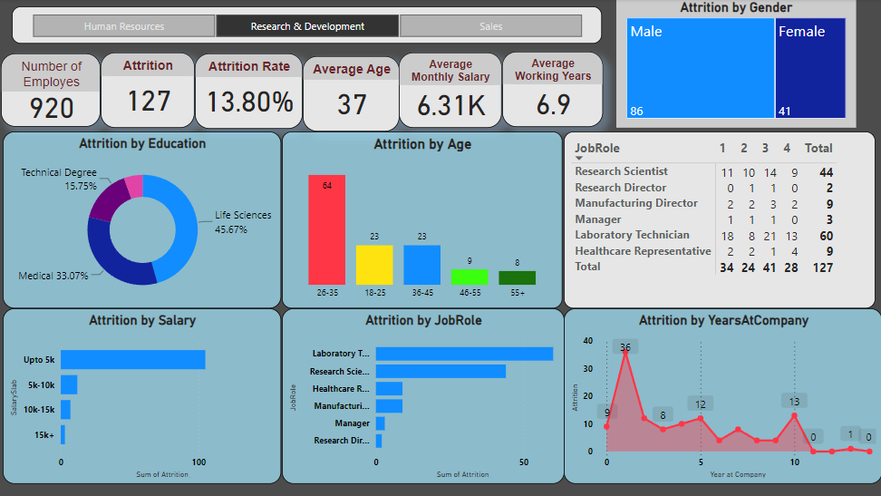

# Human Resource Data Analysis

## 📌 Project Overview
This project focuses on analysing Human Resource (HR) data to explore employee-related information and identify meaningful patterns.

The project includes data cleaning, analysis and an HR dashboard.

## 🎯 Project Objectives
- Understand and explore HR data.
- Clean and preprocess the dataset.
- Identify employee-related trends and patterns.
- Present useful insights through data analysis and visualisation.

## 🛠️ Tools & Technologies
- Python
- Pandas
- Data Visualisation

## 📂 Repository Structure
- `dashboard/` – HR dashboard files.
- `data/` – HR dataset files.
- `data_cleaning/` – Data cleaning and preprocessing files.

## ⚙️ Project Workflow
1. Explore the HR dataset.
2. Inspect the data and identify data quality issues.
3. Clean and preprocess the data.
4. Perform exploratory data analysis.
5. Develop visualisations and an HR dashboard.
6. Interpret the findings.

## 📊 Power BI Dashboard Preview

The project includes an interactive HR Analytics Dashboard
created using Microsoft Power BI.

### Dashboard KPIs
- Total Employees: 920
- Total Attrition: 127
- Attrition Rate: 13.80%
- Average Age: 37
- Average Monthly Salary: 6.31K
- Average Working Years: 6.9

### Dashboard Visualisations
- Attrition by Gender
- Attrition by Education
- Attrition by Age Group
- Attrition by Salary
- Attrition by Job Role
- Attrition by Years at Company

## 💡 Key Insights
Add 3–5 findings from your actual analysis here.

## 🚀 Future Improvements
- Improve dashboard presentation.
- Add more detailed visualisations.
- Explore additional HR metrics.

## 👩‍💻 Author
**Bidipta Roy**

GitHub: [Bidipta03](https://github.com/Bidipta03)
